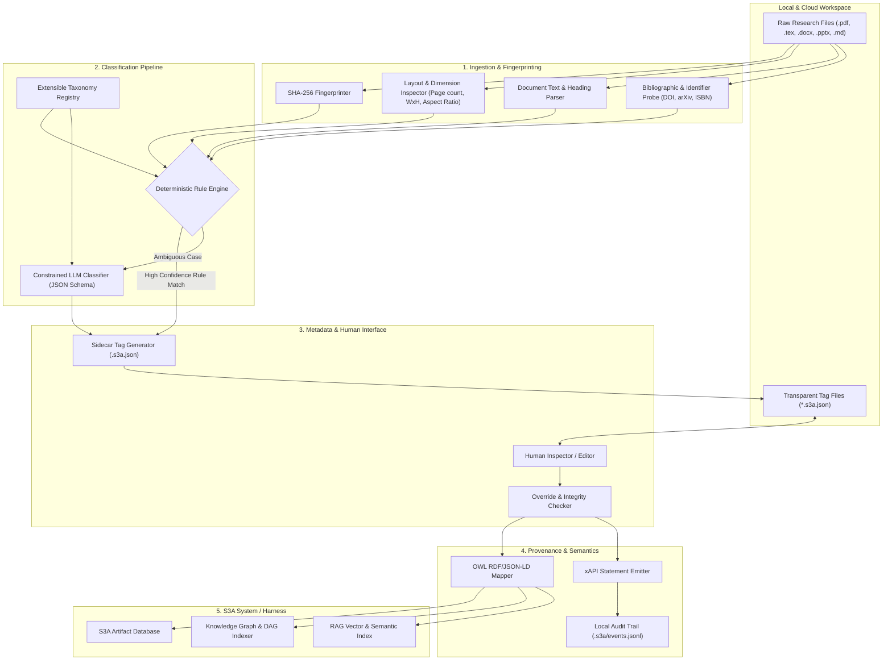

# Research Artifact Classifier and S3A Ingestion Agent

*   **Author:** S3A Architecture Team
*   **Status:** Draft
*   **Date:** 2026-11-01

--------------------------------------------------------------------------------

## Overview

Researchers produce and store diverse digital artifacts across local directories and cloud storage without consistent naming conventions or directory taxonomies. These environments hold a mixture of file formats (`.pdf`, `.docx`, `.pptx`, `.tex`, `.md`, `.txt`) fulfilling distinct functional purposes. 

This project defines an automated agent system that inspects unorganized file collections, accurately classifies artifacts, generates transparent and human-editable metadata fingerprints, captures interaction provenance through an xAPI profile, aligns metadata with an extensible OWL (Web Ontology Language) schema, and coordinates ingestion into the S3A research database without corrupting files or relying on opaque, ungrounded classifications.

--------------------------------------------------------------------------------

## The Problem

Academic directories contain overlapping file formats serving divergent roles:
- A `.pdf` file can be an external peer-reviewed journal article, an internal working draft being prepared for publication, a conference presentation slide export, or a single-page conference poster.
- A `.tex` or `.docx` file can represent an active publication manuscript, experimental protocols, rough meeting notes, or presentation notes.

Standard LLM classification approaches without structural grounding suffer from four primary failure modes:
1. **Misclassification of Author Drafts vs. Published Literature**: Agents frequently classify author-composed draft manuscripts as external published papers, leading to false citation indexing and incorrect metadata attribution.
2. **Hallucinated Tags and Semantic Drift**: LLMs invent ad-hoc tags and relationships outside the formal research ontology, preventing reproducible queries in downstream Retrieval-Augmented Generation (RAG) pipelines, Directed Acyclic Graph (DAG) workflows, and Knowledge Graph constructs.
3. **Opaque and Irreversible Tagging**: Many automated classification systems write metadata into black-box vector stores or binary headers where the researcher cannot inspect what tags were applied or correct mistakes without database administration tools.
4. **Destructive File Relocation**: Automated sorting scripts that move files based on unverified classifications break relative paths in build environments (such as LaTeX figures, bibliography files, and code repositories) and cause desynchronization in cloud-mirrored directories.

An automated system must inspect structural, bibliographic, and layout properties deterministically before semantic tagging, attach a transparent and human-editable metadata fingerprint to each artifact, allow extensible artifact class definitions, formalize relationships via OWL, track event history using xAPI, and stage all file actions for user verification before ingestion into the S3A system.

--------------------------------------------------------------------------------

## Goals

*   **Core Taxonomy with Dynamic Extensibility**: 
    *   Initialize with five baseline research artifact classes:
        1. *Academic Papers* (published external literature and preprints).
        2. *Research Notes* (informal scratchpads, experimental logs, lab notes).
        3. *Author Drafts / Manuscripts* (in-progress papers authored by the researcher for publication).
        4. *Conference Posters* (large-format single-sheet visual layouts).
        5. *Conference Presentations* (multi-slide presentation decks and talk scripts).
    *   Provide an extensible ontology registry enabling users to define and register additional artifact classes (e.g., *Grant Proposals*, *Dataset Descriptions*, *Thesis Chapters*, *Peer Review Reports*) via schema definitions without codebase modifications.
*   **Deterministic Fingerprinting & Extraction**:
    *   Compute a deterministic content hash (e.g., SHA-256) and capture file geometry (dimensions, aspect ratio, page counts), author attribution blocks, and bibliographic identifiers (DOIs, ISBNs, arXiv IDs) prior to language model inference.
*   **Transparent & Human-Editable Metadata Tags**:
    *   Attach a transparent, human-readable metadata sidecar (e.g., `.s3a.json` or plain YAML/JSON manifest) to each scanned artifact containing the fingerprint, applied classification, extraction evidence, and ontology mapping.
    *   Enable the researcher to directly inspect and edit or override any classification field. If a human edits the tag, the system treats the human correction as authoritative ground truth and updates downstream indexes accordingly.
*   **OWL Ontology Compliance**: Map all identified artifacts, custom classes, and relationships to a versioned OWL ontology to ensure semantic validity for downstream graph analyses (RAG, DAG, and Knowledge Graphs).
*   **xAPI Provenance Emission**: Generate standardized xAPI statements (`Actor`, `Verb`, `Object`, `Context`) for all lifecycle events (e.g., `scanned`, `tagged`, `human_overridden`, `verified`, `ingested`) to record an immutable audit trail.
*   **Safe Staging & Review**: Maintain non-destructive execution by generating virtual metadata tags and dry-run relocation manifests, requiring explicit user approval before physical file movement or S3A ingestion.

--------------------------------------------------------------------------------

## Non-Goals

*   **Content Rewriting or Modification**: The agent will not edit, summarize, or alter the textual contents of scanned research files.
*   **Scientific Validity & Peer Review Scoring**: The agent will not evaluate the methodology, statistical correctness, or academic merit of the papers.
*   **Arbitrary File System Reorganization**: The agent will not reorganize folders outside explicitly designated target paths or execute unprompted global file renames.
*   **Autonomous Unconstrained Taxonomy Invention**: The agent will not hallucinate random ad-hoc categories on the fly; all new artifact classes must be explicitly defined in the extensible taxonomy registry.

--------------------------------------------------------------------------------

## Open Questions

*   **Metadata Tag Persistence Strategy**: Should the transparent metadata tag be stored as a sidecar file alongside the original document (e.g., `paper.pdf.s3a.json`), in a designated `.s3a/` metadata directory within the folder, or written into standardized file-level metadata fields (e.g., PDF XMP, EXIF) where format support permits?
*   **Author Identity Grounding**: How will the agent reliably identify whether a paper was authored by the user or an external researcher when author metadata in PDFs is incomplete or missing?
*   **Physical Relocation vs. Virtual Indexing in S3A**: Should the S3A system manage artifacts via immutable content-addressed storage (hashes) and soft links, or should it physically move files into classified directory trees?
*   **xAPI LRS Endpoint vs. Local Event Store**: Will the agent dispatch xAPI statements directly to an external Learning Record Store (LRS) via HTTP, or append them to a local JSON-LD audit log within the workspace?

--------------------------------------------------------------------------------

## Critical User Journeys (CUJs)

### CUJ 1: Scan, Fingerprint, and Classify Mixed Local Research Folder
*   **Given**: A researcher has a local directory containing 200 unorganized files (`.pdf`, `.tex`, `.docx`, `.pptx`, `.md`) with no standardized naming.
*   **When**: The user directs the agent to scan the directory and classify the research artifacts.
*   **Then**: The agent computes content fingerprints, extracts structural features, resolves metadata against the OWL ontology, generates transparent metadata sidecar tags for each file, records an xAPI audit event, and produces a classification manifest showing artifact types and extraction evidence without altering the original files.

### CUJ 2: Human Correction of Mislabeled Artifact
*   **Given**: The agent classifies a preliminary grant proposal outline as a *Research Note*, generating a transparent `.s3a.json` sidecar tag.
*   **When**: The researcher opens the `.s3a.json` file (or uses chat) and changes the classification tag to `Grant Proposal` (a custom registered class).
*   **Then**: The agent detects the edit, validates it against the schema registry, accepts the human override as ground truth, emits an xAPI `corrected` event, and updates the S3A graph model.

### CUJ 3: Disambiguate Author Draft from External Published Paper
*   **Given**: A directory contains a compiled PDF of an IEEE manuscript written by the researcher alongside downloaded IEEE reference papers.
*   **When**: The agent evaluates the document metadata, author credentials, and local source file links.
*   **Then**: The agent flags the missing external publication DOI, identifies the user's name in the author block, correlates the PDF with local `.tex` source files, classifies the file as an *Author Draft*, and records this rationale in the transparent metadata tag.

### CUJ 4: Verified Staging and S3A Ingestion
*   **Given**: A generated classification manifest with staged tags and proposed S3A destinations.
*   **When**: The user reviews the manifest and confirms the staging.
*   **Then**: The agent commits the verified records and fingerprints into the S3A database and knowledge graph.

--------------------------------------------------------------------------------

## Technical Plan (Architecture)

The architecture is divided into five modular subsystems: Deterministic Extraction, Taxonomy & Ontology Engine, Transparent Tagging & Fingerprinting, xAPI Provenance Tracker, and the S3A Ingestion & Graph Bridge.



### Component Breakdown

#### 1. Ingestion & Deterministic Fingerprinting Layer
- **Content Fingerprinter**: Reads the binary stream of each file and generates a SHA-256 digest, recording exact byte length and modification timestamps.
- **Physical Geometry Inspector**:
  - PDF: Parses bounding boxes and mediabox coordinates. Dimensions > 24" x 36" (or equivalent ISO A0/A1) flag *Conference Posters*. Aspect ratios of 16:9 or 4:3 across multiple pages flag *Conference Presentations*.
  - Office Presentations (`.pptx`): Inspects slide geometry and note slides.
  - LaTeX / Word / Markdown (`.tex`, `.docx`, `.md`): Reads document class declarations (e.g., `\documentclass{beamer}` vs `\documentclass{article}`), section headers, and title blocks.
- **Bibliographic & Local Author Correlator**:
  - Searches for valid DOI strings, arXiv identifier patterns, and publication copyright statements.
  - Cross-references author names in the document against the local `user_profile.json` (user name, aliases, lab members).
  - Searches the local filesystem for matching sibling source files (e.g., if `paper.pdf` shares a directory with `paper.tex`, `references.bib`, and an image assets folder, it is flagged as an active *Author Draft*).

#### 2. Extensible Taxonomy & Semantic Reasoning Engine
- **Deterministic Fast-Path**: Resolves classifications with definitive structural indicators without invoking LLM tokens:
  - Multi-page 16:9 presentation layout or `.pptx` -> *Conference Presentation*.
  - Single-page large format (>800mm dimension) -> *Conference Poster*.
  - Presence of registered publication DOI + external authors -> *Academic Paper*.
  - Presence of local `.tex` project + matching user author name -> *Author Draft*.
- **Constrained LLM Classifier**: For ambiguous artifacts (e.g., short notes, literature summaries, unfinished drafts):
  - Ingests first 2,000 tokens (title, abstract, introductory headers).
  - Emits output conforming to a strict JSON Schema returning one of the registered classes, extraction evidence, and confidence score.
- **Extensible Schema Registry**: Defines valid artifact classes in `taxonomy_registry.yaml`. New classes (e.g., `GrantProposal`, `DatasetDescriptor`) can be added by declaring required structural hints and subclass relations.

#### 3. Transparent Metadata Sidecar (`.s3a.json`)
Each artifact file `document.ext` receives an adjacent human-readable sidecar file `document.ext.s3a.json`:

```json
{
  "$schema": "https://s3a.org/schemas/artifact-tag.v1.json",
  "fingerprint": {
    "sha256": "e3b0c44298fc1c149afbf4c8996fb92427ae41e4649b934ca495991b7852b855",
    "byte_size": 1420580,
    "last_scanned": "2026-11-01T10:45:00Z"
  },
  "classification": {
    "class": "AuthorDraft",
    "confidence": 0.94,
    "source": "deterministic_rule",
    "rationale": "Matches local author in user_profile.json; sibling file 'main.tex' present."
  },
  "human_override": {
    "active": false,
    "original_class": null,
    "updated_by": null,
    "updated_at": null,
    "notes": null
  },
  "attributes": {
    "title": "Scalable Ontology Alignment for Autonomous Agent Swarms",
    "authors": ["Ashley Smith", "Collaborator Name"],
    "doi": null,
    "page_count": 12,
    "dimensions": "Letter"
  },
  "ontology_iri": "http://s3a.org/ontology#AuthorDraft"
}
```

If a user edits `"class": "GrantProposal"` and sets `"active": true` (or simply changes the class in a text editor), the `OverrideValidator` registers the modification as verified truth.

#### 4. OWL Web Ontology Integration
The system integrates a formal OWL 2 DL ontology (`s3a-research-ontology.owl`):
- **Core Classes**:
  - `s3a:ResearchArtifact` (Abstract root class)
    - `s3a:AcademicPaper` (`owl:disjointWith s3a:ResearchNote`)
    - `s3a:AuthorDraft` (`owl:equivalentClass`: artifact with `s3a:hasAuthor` containing local researcher and status `in_progress`)
    - `s3a:ResearchNote`
    - `s3a:ConferencePoster`
    - `s3a:ConferencePresentation`
- **Object Properties**:
  - `s3a:isDraftOf`: Links an `AuthorDraft` to a target `AcademicPaper`.
  - `s3a:hasSourceFile`: Links compiled output to editable source (`.tex` / `.docx`).
  - `s3a:citesLiterature`: Links an artifact to cited external papers.
  - `s3a:derivedFromNote`: Links an author draft to foundational research notes.
- **Data Properties**:
  - `s3a:contentHash` (`xsd:string`, unique constraint).
  - `s3a:pageCount` (`xsd:integer`).
  - `s3a:publicationDoi` (`xsd:string`).

#### 5. xAPI Research Profile & Provenance Tracking
To ensure total auditability and zero silent drift, the agent generates xAPI statements formatted according to an IEEE/xAPI research profile:

```json
{
  "actor": {
    "name": "S3A Classifier Agent",
    "mbox": "mailto:agent@s3a.local"
  },
  "verb": {
    "id": "http://s3a.org/xapi/verbs/classified",
    "display": { "en-US": "classified" }
  },
  "object": {
    "id": "urn:sha256:e3b0c44298fc1c149afbf4c8996fb92427ae41e4649b934ca495991b7852b855",
    "definition": {
      "name": { "en-US": "paper.pdf" },
      "type": "http://s3a.org/ontology#AuthorDraft"
    }
  },
  "context": {
    "contextActivities": {
      "category": [{ "id": "http://s3a.org/xapi/profiles/research-artifact-management" }]
    },
    "extensions": {
      "http://s3a.org/xapi/ext/confidence": 0.94,
      "http://s3a.org/xapi/ext/sidecar_path": "./paper.pdf.s3a.json"
    }
  },
  "timestamp": "2026-11-01T10:45:00Z"
}
```

When a human overrides a tag, an event with verb `http://s3a.org/xapi/verbs/overrode` is logged with the human user as the actor and the agent's prior classification preserved in context extensions.

#### 6. S3A Ingestion & Graph Bridge
- Ingestion occurs only after verification (either implicit high-confidence threshold or explicit user review).
- S3A builds a tripartite representation:
  - **Relational / Document Metadata**: Stores file paths, content hashes, and extracted bibliographies.
  - **Knowledge Graph (Triplestore / Property Graph)**: Loads OWL-conforming RDF triples to power semantic queries (e.g., "Find all author drafts that cite paper X and originated from lab notes in Folder Y").
  - **RAG / Vector Index**: Indexes clean text chunks tagged with ontological metadata, ensuring search queries can filter by artifact type (e.g., retrieving context solely from *Academic Papers* vs. informal *Research Notes*).

--------------------------------------------------------------------------------

## Alternatives Considered

### Alternative A: Direct Binary In-File Metadata Embedding (XMP / EXIF / Custom Properties)

*   **Mechanism**: Embed classifications, ontology IRIs, and fingerprints directly inside file headers (e.g., PDF XMP metadata streams, Office custom document properties, or extended filesystem attributes / xattrs).
*   **Pros**:
    *   Metadata travels with the file automatically during OS-level file moves and renames.
    *   Avoids creating secondary sidecar files in researcher folders.
*   **Cons**:
    *   Modifying file headers alters the raw binary contents, invalidating the original cryptographic hash (SHA-256) and risking file corruption on complex PDF/Word streams.
    *   Format fragmentation: LaTeX (`.tex`), Markdown (`.md`), and plain text (`.txt`) files lack standardized in-file metadata wrappers.
    *   Requires specialized binary editors or command-line utilities for a human to view or edit the tags, eliminating direct transparency.
*   **Reason for Rejection**: Violates the non-destructive file preservation requirement, invalidates deterministic hashing, and prevents simple human inspection and text editing.

### Alternative B: Centralized Black-Box Vector Database Tagging (No Local Files)

*   **Mechanism**: Store document embeddings, classifications, and metadata strictly in a centralized database (e.g., PostgreSQL + pgvector, Chroma, or Pinecone) without generating any local metadata files.
*   **Pros**:
    *   Leaves local user directories untouched and clean of extra files.
    *   Simplifies metadata indexing for cloud-first workflows.
*   **Cons**:
    *   Completely opaque to the researcher; verifying or editing tags requires accessing a database console or custom web dashboard.
    *   Tightly couples the researcher's local files to a specific running agent instance. If files are copied to an external drive, USB, or another computer, all semantic tagging and provenance context is severed.
*   **Reason for Rejection**: Fails the requirement for transparent, decentralized metadata that researchers can directly inspect, edit, and retain with their files.

### Alternative C: End-to-End Multimodal LLM Zero-Shot Classification (No Deterministic Rules)

*   **Mechanism**: Feed page renderings or raw text extracts of every file directly to a vision-language model to decide artifact classifications in a single prompt without geometry inspection or bibliographic probes.
*   **Pros**:
    *   Minimizes local parsing logic, regex scripts, and PDF layout extraction libraries.
    *   Single uniform processing path for all file types.
*   **Cons**:
    *   Prohibitive API cost and latency when scanning research workspaces containing thousands of files.
    *   High vulnerability to hallucination when evaluating borderline documents (e.g., mistaking a user's drafted manuscript for a published reference paper due to identical template styles).
    *   Cannot reliably verify external publication registries (Crossref, DOI) or local sibling source dependencies without custom tooling anyway.
*   **Reason for Rejection**: Unacceptable hallucination risk, high latency, and unnecessary operational cost compared to deterministic fast-path evaluation.

### Alternative D: Autonomous Immediate Directory Reorganization (Automatic File Moving)

*   **Mechanism**: Immediately move files into physical subdirectories (e.g., `/Papers`, `/Drafts`, `/Posters`, `/Slides`) upon classification.
*   **Pros**:
    *   Produces an immediately tidy physical folder layout.
*   **Cons**:
    *   Breaks relative paths in active code repositories, LaTeX builds (`\input`, `\includegraphics`), and bibliography references (`.bib`).
    *   If an agent misclassifies an author's in-progress manuscript and moves it to another folder, the local build environment breaks and files can be lost.
*   **Reason for Rejection**: Poses an unacceptably high risk of silent project breakage. Decoupling semantic metadata tagging from physical file relocation protects project integrity.

--------------------------------------------------------------------------------

## Non-Functional Requirements

### Security & Privacy
*   **Local-First Execution**: File scanning, geometry extraction, and hash calculations occur strictly on the local machine. Sensitive unreleased manuscripts and private lab notes are never transmitted to external APIs unless LLM fallback is explicitly authorized.
*   **Non-Destructive File Invariant**: Scanners operate with read-only file handles on original documents. The agent is strictly prohibited from altering, overwriting, or truncating user research files.

### Reliability & Data Integrity
*   **Cryptographic Fingerprint Integrity**: All metadata sidecars are bonded to files via SHA-256 hashes. If a file is modified after tagging, the hash mismatch immediately flags the metadata as stale and triggers a re-scan.
*   **Idempotency**: Repeated scans of unchanged files must produce identical fingerprints and classifications without re-invoking LLM inference or generating duplicate xAPI statements.

### Performance & Latency
*   **Fast-Path Throughput**: The deterministic rule engine must process standard files (geometry, aspect ratio, page counts, DOI regex) at >50 files per second on local SSDs.
*   **LLM Token Conservation**: Language model evaluation is restricted to the first 2,000 tokens of ambiguous files only, avoiding full-document context window dumps.

--------------------------------------------------------------------------------

## Detailed Implementation Plan

The implementation is executed as a unified eight-stage sequence ensuring no ambiguous decisions are deferred to the implementation phase:

1. **Stage 1: Schemas & Ontology Formalization**: Establish JSON Schema for sidecars, YAML schema for the extensible taxonomy registry, and compile the OWL 2 DL ontology artifact.
2. **Stage 2: Deterministic Ingestion & Fingerprinting**: Construct cryptographic hashing and geometry inspection modules for PDF, PPTX, TeX, Docx, and Markdown files.
3. **Stage 3: Bibliographic & Identity Extraction**: Implement DOI/arXiv regex extractors and author attribution matching against local user profiles.
4. **Stage 4: Classification Engine**: Build the deterministic fast-path rule pipeline and the schema-constrained LLM fallback client.
5. **Stage 5: Transparent Sidecar Tagging**: Implement sidecar serialization, deserialization, orphan recovery, and human override detection.
6. **Stage 6: xAPI Provenance Pipeline**: Construct the event logger generating actor-verb-object statements for all scan, classify, override, and ingest events.
7. **Stage 7: S3A Ingestion Bridge**: Build the interface loading verified metadata into S3A relational tables, RDF triplestores, and vector indexes.
8. **Stage 8: CLI Interface & Test Verification**: Expose user-facing and agentic CLI commands and execute unit, integration, and compliance test suites.

### Target Files to Create/Modify

#### 1. `schemas/artifact_tag.v1.json` (Create)
*   **Type / Scope**: JSON Schema Definition
*   **Rationale**: Defines the strict structural schema for transparent sidecar files (`<filename>.s3a.json`). Ensures every sidecar file maintains required fingerprint fields, confidence metrics, human override blocks, and ontology mappings.
*   **Proposed Structural Contract**:
    *   `fingerprint`: Requires `sha256` (regex `^[a-f0-9]{64}$`), `byte_size` (integer), and `last_scanned` (date-time).
    *   `classification`: Requires `class` (string), `confidence` (float 0.0-1.0), `source` (`deterministic_rule` | `llm_fallback` | `human_override`), and `rationale` (string).
    *   `human_override`: Requires `active` (boolean), `original_class` (nullable string), `updated_by` (nullable string), `updated_at` (nullable date-time), and `notes` (nullable string).
    *   `ontology_iri`: Requires valid URI string.

#### 2. `schemas/taxonomy_registry.yaml` (Create)
*   **Type / Scope**: YAML Configuration / Schema Registry
*   **Rationale**: Provides an extensible registry defining baseline artifact classes and custom user-defined classes without modifying codebase logic.
*   **Proposed Structural Contract**:
    *   `classes`: Key-value mapping of class names (`AcademicPaper`, `AuthorDraft`, `ResearchNote`, `ConferencePoster`, `ConferencePresentation`).
    *   Each entry declares: `display_name`, `description`, `parent_class` (`s3a:ResearchArtifact`), `rules` (required extensions, geometry bounds, author matching requirements), and `ontology_iri`.
    *   Supports dynamic registration of custom classes (e.g., `GrantProposal`, `DatasetDescriptor`).

#### 3. `ontology/s3a_research_ontology.owl` (Create)
*   **Type / Scope**: OWL 2 DL Semantic Web Ontology (Turtle / XML-RDF)
*   **Rationale**: Formalizes classes, disjointness constraints, and object/data properties to ensure semantic consistency in downstream S3A knowledge graphs and RAG pipelines.
*   **Proposed Structural Contract**:
    *   Defines root class `s3a:ResearchArtifact`.
    *   Declares core subclasses: `s3a:AcademicPaper`, `s3a:AuthorDraft`, `s3a:ResearchNote`, `s3a:ConferencePoster`, `s3a:ConferencePresentation`.
    *   Declares disjoint axioms: `s3a:AcademicPaper owl:disjointWith s3a:ResearchNote`.
    *   Declares properties: `s3a:hasFingerprint`, `s3a:hasSourceFile`, `s3a:isDraftOf`, `s3a:publicationDoi`, `s3a:hasAuthor`.

#### 4. `src/config.py` (Create)
*   **Type / Scope**: Python Pydantic Configuration Model
*   **Rationale**: Manages runtime settings, threshold parameters, paths to ontology and registry files, and local author identity configuration.
*   **Proposed Structural Contract**:
    *   `UserProfileConfig`: Stores `author_names` (list of strings), `orcid`, `institutions`, and `known_collaborators`.
    *   `ScannerConfig`: Stores `target_directories`, `sidecar_extension` (`.s3a.json`), `hash_algorithm` (`sha256`), and `max_llm_tokens` (2048).
    *   `S3AConfig`: Stores database connection strings, LRS endpoint URLs, and staging paths.

#### 5. `src/fingerprint.py` (Create)
*   **Type / Scope**: Python Module (Cryptographic & Filesystem Utilities)
*   **Rationale**: Generates deterministic SHA-256 digests from file byte streams and inspects basic filesystem attributes with read-only guarantees.
*   **Proposed Structural Contract**:
    *   `compute_file_fingerprint(file_path: Path) -> FingerprintResult`: Returns `sha256`, `byte_size`, and `mtime`.
    *   `verify_fingerprint(file_path: Path, expected_hash: str) -> bool`: Checks whether the existing document matches the stored hash, detecting stale sidecars.

#### 6. `src/extractors/geometry.py` (Create)
*   **Type / Scope**: Python Module (Layout & Dimension Inspector)
*   **Rationale**: Extracts physical dimensions, page counts, and aspect ratios from PDFs and PPTX files to deterministically flag posters and slide presentations.
*   **Proposed Structural Contract**:
    *   `inspect_pdf_geometry(file_path: Path) -> GeometryResult`: Uses PDF parser to extract `page_count`, `mediabox_dimensions` (width and height in inches/mm), and `aspect_ratio`.
    *   Flags `is_large_format` (width or height >= 24 inches / 610mm) for posters.
    *   Flags `is_slide_aspect_ratio` (16:9 or 4:3 across >= 3 pages) for presentations.
    *   `inspect_pptx_geometry(file_path: Path) -> GeometryResult`: Extracts slide counts, layout dimensions, and speaker note presence.

#### 7. `src/extractors/bibliographic.py` (Create)
*   **Type / Scope**: Python Module (Bibliographic Identifier & Header Probe)
*   **Rationale**: Detects published DOIs, arXiv IDs, and publication headers to distinguish published literature from informal notes.
*   **Proposed Structural Contract**:
    *   `extract_identifiers(text: str) -> BibliographicIdentifiers`: Runs regex pipelines for DOIs (`10.\d{4,9}/[-._;()/:A-Za-z0-9]+`), arXiv IDs (`\d{4}\.\d{4,5}`), and ISBNs.
    *   `check_publication_headers(text: str) -> bool`: Scans for standard publisher copyright stamps (IEEE, ACM, Springer, Elsevier, Nature).

#### 8. `src/extractors/author_matcher.py` (Create)
*   **Type / Scope**: Python Module (Author Identity & Sibling Source Probe)
*   **Rationale**: Disambiguates user-authored drafts from external peer papers by checking author blocks and local sibling source files (`.tex`, `.bib`, `figures/`).
*   **Proposed Structural Contract**:
    *   `match_author_identity(doc_text: str, profile: UserProfileConfig) -> AuthorMatchResult`: Evaluates presence of user aliases in first-page author blocks.
    *   `find_sibling_source_files(file_path: Path) -> SiblingAnalysisResult`: Inspects directory of `file_path` for companion `.tex`, `.docx`, `.bib`, or `figures/` assets sharing base names or containing cross-references.

#### 9. `src/classifier/engine.py` (Create)
*   **Type / Scope**: Python Module (Classification Orchestrator)
*   **Rationale**: Executes the two-stage classification pipeline: deterministic fast-path rules first, followed by constrained LLM fallback for ambiguous cases.
*   **Proposed Structural Contract**:
    *   `classify_artifact(file_path: Path) -> ClassificationResult`: Runs fingerprinting, geometry extraction, bibliographic probe, and author matching.
    *   Evaluates fast-path heuristics against `taxonomy_registry.yaml`.
    *   If fast-path confidence < 0.85, passes extracted headers and metadata to `LLMClassifierClient`.
    *   Returns definitive class, confidence score, source (`deterministic_rule` or `llm_fallback`), and rationale.

#### 10. `src/classifier/llm_client.py` (Create)
*   **Type / Scope**: Python Module (Structured LLM Client)
*   **Rationale**: Provides structured LLM inference enforcing JSON Schema output for ambiguous documents, eliminating ungrounded hallucinations.
*   **Proposed Structural Contract**:
    *   `classify_with_schema(text_snippet: str, available_classes: list[str]) -> LLMClassificationResponse`: Sends system prompt and truncated document snippet (<= 2048 tokens), validating responses against schema definitions.

#### 11. `src/sidecar/manager.py` (Create)
*   **Type / Scope**: Python Module (Transparent Sidecar Management)
*   **Rationale**: Generates, writes, reads, and updates human-readable `<filename>.s3a.json` sidecar files adjacent to scanned research artifacts.
*   **Proposed Structural Contract**:
    *   `create_sidecar(file_path: Path, result: ClassificationResult) -> Path`: Writes formatted JSON sidecar adjacent to the target file.
    *   `load_sidecar(file_path: Path) -> SidecarData`: Reads and parses existing sidecar file.
    *   `scan_orphan_sidecars(directory: Path) -> list[Path]`: Identifies sidecars whose source file has moved, attempting re-linking by SHA-256 fingerprint.

#### 12. `src/sidecar/validator.py` (Create)
*   **Type / Scope**: Python Module (Override & Integrity Validator)
*   **Rationale**: Detects manual human edits to sidecars, validates edited classes against the taxonomy registry, and ensures cryptographic hash integrity.
*   **Proposed Structural Contract**:
    *   `validate_sidecar_integrity(sidecar_path: Path) -> ValidationStatus`: Verifies that target file still exists and that SHA-256 hash has not drifted.
    *   `detect_human_override(sidecar_path: Path, previous_state: dict) -> OverrideResult`: Flags if human edited `class` or toggled `human_override.active`, validating the new class against `taxonomy_registry.yaml`.

#### 13. `src/provenance/xapi.py` (Create)
*   **Type / Scope**: Python Module (xAPI Statement Generator)
*   **Rationale**: Produces immutable IEEE/xAPI audit events for all scan, classify, override, and ingest lifecycle actions.
*   **Proposed Structural Contract**:
    *   `emit_xapi_statement(actor: dict, verb: str, artifact_hash: str, context: dict) -> dict`: Builds standardized xAPI statement payload and appends to local `.s3a/events.jsonl` or posts to an HTTP LRS endpoint.

#### 14. `src/s3a/bridge.py` (Create)
*   **Type / Scope**: Python Module (S3A Storage & Graph Integration Bridge)
*   **Rationale**: Commits verified metadata records into the S3A research database, loads OWL RDF triples into the property graph, and feeds filtered text to RAG vector indexes.
*   **Proposed Structural Contract**:
    *   `ingest_verified_artifact(sidecar_data: SidecarData) -> IngestionResult`: Inserts artifact record into S3A relational schema, writes RDF triples mapped to `s3a_research_ontology.owl`, and updates RAG index with artifact class tags.

#### 15. `src/cli.py` (Create)
*   **Type / Scope**: Python CLI & Agent Tooling Entrypoint
*   **Rationale**: Provides command-line actions for humans and automated agents to scan, inspect, override, verify, and ingest artifacts.
*   **Proposed Structural Contract**:
    *   Commands:
        *   `s3a-agent scan <path>`: Scans directory, calculates fingerprints, and generates staging manifest.
        *   `s3a-agent tag <path>`: Writes transparent `.s3a.json` sidecar files.
        *   `s3a-agent override <file> <new_class> --notes <notes>`: Applies human correction to sidecar tag.
        *   `s3a-agent verify <path>`: Confirms staged classifications.
        *   `s3a-agent ingest <path>`: Commits verified artifacts into S3A database and graph.
        *   `s3a-agent status <path>`: Reports directory classification summary, staleness, and overrides.

#### 16. `tests/test_fingerprint.py` (Create)
*   **Type / Scope**: Unit Test Suite
*   **Rationale**: Tests SHA-256 calculation, read-only guarantees, and staleness detection when files are modified.

#### 17. `tests/test_geometry.py` (Create)
*   **Type / Scope**: Unit Test Suite
*   **Rationale**: Validates page dimension parsing, poster detection (>24x36 inches), and presentation aspect ratio detection (16:9, 4:3) across synthetic test PDFs and PPTX files.

#### 18. `tests/test_classifier.py` (Create)
*   **Type / Scope**: Unit Test Suite
*   **Rationale**: Tests deterministic disambiguation between author drafts (matching user profile and sibling `.tex` files) and external published papers (containing valid DOI and external authors).

#### 19. `tests/test_sidecar_override.py` (Create)
*   **Type / Scope**: Unit Test Suite
*   **Rationale**: Tests human editing workflow: manually updating a `.s3a.json` file, validating new class against `taxonomy_registry.yaml`, and ensuring an xAPI `overrode` statement is recorded.

#### 20. `tests/test_ontology_compliance.py` (Create)
*   **Type / Scope**: Unit Test Suite
*   **Rationale**: Validates generated RDF triples against `s3a_research_ontology.owl` using an RDF/OWL validator to ensure zero disjointness violations or schema corruption.

#### 21. `README.md` (Create)
*   **Type / Scope**: Project Documentation
*   **Rationale**: Documents setup, architecture, taxonomy customization, sidecar format, xAPI profile, and CLI usage.

---

### Verification Plan

#### Compilation & Environment Setup
*   Environment Manager: Python 3.11+ managed via `uv` or standard virtualenv.
*   Dependency Installation: `pip install -e .` with dependencies (`pypdf`, `python-pptx`, `pydantic`, `pyyaml`, `rdflib`, `pytest`, `jsonschema`).

#### Automated Test Execution
*   **Unit Tests**: `pytest tests/`
    *   `test_fingerprint.py`: Verify SHA-256 accuracy and mtime checks.
    *   `test_geometry.py`: Validate dimensions for posters (A0/A1), slides (16:9), and standard letters.
    *   `test_classifier.py`: Validate deterministic rule paths and schema constraints.
    *   `test_sidecar_override.py`: Verify human override recognition and xAPI emission.
    *   `test_ontology_compliance.py`: Verify RDF triple generation against OWL ontology.
*   **Static Analysis & Linting**:
    *   Type checking: `mypy src/`
    *   Linting and formatting: `ruff check src/ tests/`
*   **Test Coverage Requirement**: Minimum 90% branch coverage across `src/extractors/`, `src/classifier/`, and `src/sidecar/`.

#### End-to-End Simulation
*   Create a mock research workspace containing:
    *   2 external published PDFs with real DOIs.
    *   1 user-authored manuscript PDF paired with `main.tex` and user author credentials.
    *   1 conference poster PDF (single-page 36" x 48").
    *   1 conference presentation (`.pptx` with 15 slides).
    *   2 markdown research notes (`notes.md`, `scratchpad.md`).
*   Execute `s3a-agent scan ./mock_workspace` and `s3a-agent tag ./mock_workspace`.
*   Verify 100% classification accuracy on the 5 baseline classes.
*   Perform manual edit on one sidecar tag, run `s3a-agent status`, and verify the human override is registered, validated, and logged to `events.jsonl`.
*   Run `s3a-agent ingest ./mock_workspace` and verify RDF graph integrity and S3A database records.

--------------------------------------------------------------------------------

*Drafted with EGM*
