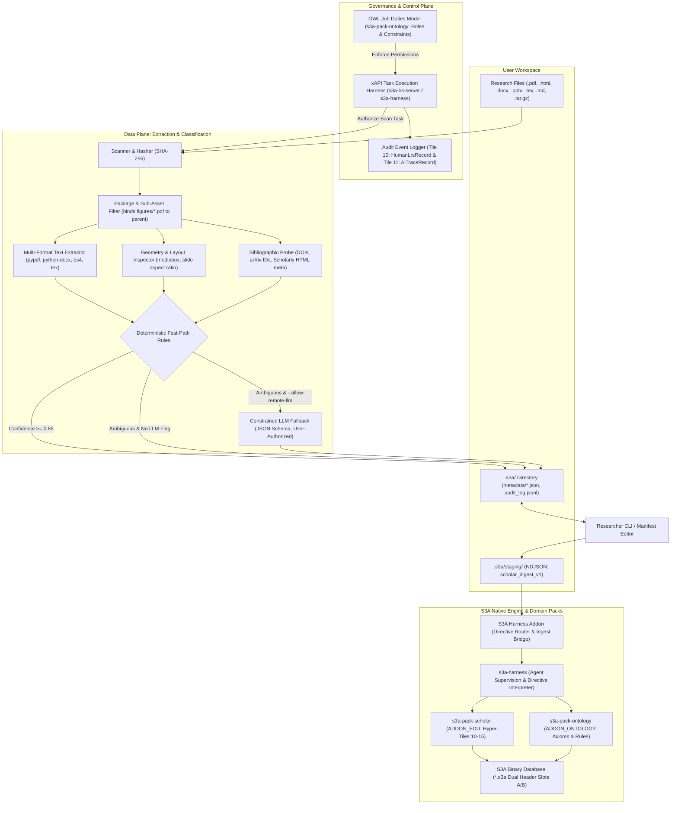

# Research Artifact Classifier and S3A Ingestion Agent

*   **Author:** S3A Architecture Team
*   **Status:** Proposed (Resolved via EGM Goldfish Review)
*   **Date:** 2026-11-01

--------------------------------------------------------------------------------

## Overview

Researchers produce and accumulate diverse digital artifacts across local workspaces and cloud storage without consistent naming conventions or directory taxonomies. These environments contain a mixture of file formats (`.pdf`, `.html`, `.docx`, `.pptx`, `.tex`, `.md`, `.tar.gz`, `.zip`) fulfilling distinct functional purposes.

This project defines an autonomous agent system for the **Spatial-Semantic Storage Architecture (S3A)** system, interfacing directly via the **S3A Harness Addon** and the native **Scholar Domain Pack (`s3a-pack-scholar`)**. The system deterministically inspects unorganized research collections, categorizes artifacts without hallucination, formats them into native S3A physical storage tiles, and commits them to an authoritative S3A binary archive (`*.s3a`).

The S3A platform adheres strictly to a **Zero External Database Architecture** (no SQLite, no DuckDB, no PostgreSQL, and no external document stores). All live querying, xAPI 1.0.3 statement logging, cognitive trace auditing, and knowledge graph navigation execute natively on S3A binary archives (`*.s3a`).

Crucially, the architecture establishes a dual-plane governance model integrated with the S3A Harness and Domain Packs:
1. **OWL Web Ontology as the Agent "Job Duties" Model (`s3a-pack-ontology`)**: Formally defines agent roles, permitted capabilities, artifact boundaries, and legal state transitions, ensuring agents never execute actions outside their assigned duties.
2. **xAPI Profile as the Agent "Job Manual" Harness (`s3a-lrs-server`)**: Enforces runtime task execution contracts where every agent action must validate against an authorized xAPI 1.0.3 statement (`Actor`, `Verb`, `Object`, `Context`) submitted through the S3A Harness Addon, preventing capability drift and unverified file mutations.

--------------------------------------------------------------------------------

## Problem Statement

Academic workspaces contain overlapping file formats serving divergent roles:
- A `.pdf` file can be an external peer-reviewed article, an internal working draft being prepared for publication, a slide export, a single-page poster, or a standalone figure plot (`figures/fig1.pdf`) belonging to a parent LaTeX manuscript.
- Modern scholarly preprints are distributed not only as PDFs, but as **compound source packages** (`.tar.gz` / `.zip` containing LaTeX sources, macros, and figure sub-assets, as seen in arXiv submissions) and **responsive Scholarly HTML preprints** (HTML5 with embedded MathML and metadata).
- A `.tex`, `.html`, or `.docx` file can represent an active publication manuscript, experimental protocols, rough reading notes, or presentation notes.

Unconstrained AI agents operating on research folders suffer from four core failure modes:
1. **Misclassification of Sub-Assets and Compound Packages**: Treating auxiliary figure PDFs (`figures/*.pdf`) within a LaTeX package as standalone posters or papers, spraying metadata across source trees.
2. **Author Draft vs. Published Literature Conflation**: Mistaking a user's working draft for an external published paper—or conversely, mislabeling a researcher's downloaded copy of their own past published paper as an active draft.
3. **Agent Capability Drift & Hallucinated Actions**: Agents lacking a formal "job manual" invent ad-hoc taxonomy labels, execute unprompted file movements that sever relative build dependencies (`\input`, `\includegraphics`, `.bib`), or transmit confidential unreleased manuscripts to third-party APIs.
4. **Workspace Pollution and Opaque Tagging**: Storing classifications in opaque vector databases or scattering hundreds of uncontained sidecar files across project folders, cluttering version control systems and triggering cloud synchronization thrashing.

--------------------------------------------------------------------------------

## Goals

*   **Compound & Multi-Format Taxonomy**:
    *   Classify research artifacts across six baseline classes:
        1. *Academic Papers* (published peer-reviewed literature and preprints in PDF or Scholarly HTML).
        2. *Author Drafts / Manuscripts* (active, in-progress papers authored by the researcher for publication).
        3. *Research Notes* (informal scratchpads, experimental logs, lab notes).
        4. *Conference Posters* (large-format single-sheet visual layouts).
        5. *Conference Presentations* (multi-slide presentation decks and talk scripts).
        6. *Source Packages / Compound Archives* (compressed `.tar.gz` / `.zip` submission archives containing manuscript sources and assets).
    *   Provide an extensible YAML schema registry (`schemas/taxonomy_registry.yaml`) enabling researchers to register custom classes (e.g., *Grant Proposals*, *Dataset Descriptors*) without codebase refactoring.
*   **Agent "Job Duties" via OWL Governance Model**:
    *   Deploy a versioned OWL 2 DL ontology (`s3a_agent_governance.owl`) specifying agent roles, task permissions, allowable tool operations, and artifact boundary constraints to semantically govern agent behavior.
*   **Agent "Job Manual" via xAPI Task Execution Harness**:
    *   Constrain all agent execution to an xAPI task execution profile. Every action (scan, extract, categorize, override, ingest) must be validated against authorized actor-verb-object-context contracts before execution, generating an immutable audit trail (`.s3a/audit_log.jsonl`).
*   **Deterministic Inspection & Asset Filtering**:
    *   Compute cryptographic SHA-256 digests and extract physical geometry, bibliographic headers (DOIs, arXiv IDs, Highwire Press `<meta>` tags), and author identifiers deterministically.
    *   Filter and bind sub-asset figures (`figures/*.pdf`) to parent manuscript packages rather than classifying them as standalone documents.
*   **Clean Workspace & Centralized Metadata**:
    *   Store metadata manifests in a centralized, hidden workspace directory (`.s3a/metadata/<sha256>.json`), keeping project working trees and Git repositories clean.
    *   Allow direct human inspection and authoritative overrides of metadata manifests.
*   **Non-Destructive Virtual Ingestion**:
    *   Guarantee that original research files are never moved, renamed, or modified. Ingestion into S3A registers content-addressed references and metadata into local storage.

--------------------------------------------------------------------------------

## Non-Goals

*   **Physical File System Reorganization**: The agent will not move, rename, or delete user research files. All organization is virtual within the S3A catalog.
*   **Content Rewriting or Modification**: The agent will not alter, reformat, or edit document contents.
*   **Scientific Validity Scoring**: The agent will not peer-review or judge the academic merit of papers.
*   **Silent External API Transmission**: The agent will not send document text to remote LLMs without an explicit user authorization flag.

--------------------------------------------------------------------------------

## Critical User Journeys (CUJs)

### CUJ 1: Scan and Categorize Mixed Workspace with Compound Archives
*   **Given**: A local research directory containing downloaded papers (`.pdf`, `.html`), an unpacked LaTeX project with sub-figure PDFs (`figures/fig1.pdf`), and an archived submission (`arXiv-2607.02514v1.tar.gz`).
*   **When**: The user commands the agent to scan and categorize the workspace.
*   **Then**: The agent computes content fingerprints, recognizes `arXiv-2607.02514v1.tar.gz` as a *Source Package*, identifies `figures/fig1.pdf` as a sub-asset bound to the parent `main.tex`, categorizes the papers without touching source trees, and writes manifests into `.s3a/metadata/`.

### CUJ 2: Agent Runtime Governance via Job Duties & Job Manual
*   **Given**: An autonomous subagent tasked with categorizing research notes.
*   **When**: The subagent attempts an unassigned destructive action (e.g., deleting a file or classifying an unassigned patent file).
*   **Then**: The governance harness intercepts the action against the OWL "Job Duties" model and xAPI "Job Manual" contract, rejects the unassigned verb, aborts the operation, and logs a violation event to `.s3a/audit_log.jsonl`.

### CUJ 3: Authoritative Human Override of Metadata
*   **Given**: An internal grant proposal outline is classified by heuristic rules as a *Research Note*.
*   **When**: The researcher updates the manifest class to `GrantProposal` via the CLI or by editing `.s3a/metadata/<sha256>.json`.
*   **Then**: The system validates the new class against `taxonomy_registry.yaml`, accepts the human edit as ground truth, updates the manifest with `human_override.active = true`, and emits an xAPI `overrode` statement.

### CUJ 4: Disambiguate Author Draft from User's Past Published Paper
*   **Given**: A folder contains a user's active manuscript `draft.pdf` (with local `draft.tex`) alongside a downloaded PDF of the user's previously published IEEE journal paper.
*   **When**: The agent evaluates author matching and publication status.
*   **Then**: The agent identifies the registered publication DOI on the IEEE paper and classifies it as an *Academic Paper* (with `is_user_authored = true`), while classifying `draft.pdf` as an active *Author Draft* due to missing publication DOI and active local source files.

### CUJ 5: Virtual Ingestion into S3A Database
*   **Given**: A verified set of artifact manifests in `.s3a/metadata/`.
*   **When**: The user executes `s3a-agent ingest`.
*   **Then**: The agent connects to the S3A Database via the S3A harness client and registers content-addressed file hashes, verified metadata manifests, and ontology relationships directly into the S3A research database and knowledge graph without altering a single original file.

--------------------------------------------------------------------------------

## Technical Plan (Architecture)

The system separates the **Data Plane** (file scanning, deterministic extraction, categorization) from the **Governance / Control Plane** (OWL job duties, xAPI task harness, human oversight).



### Component Breakdown

#### 1. Compound Archive & Sub-Asset Filtering Layer
*   **Archive Introspection**: Inspects `.tar.gz` and `.zip` files using standard library `tarfile` and `zipfile` without full disk decompression. Detects root manuscripts (`main.tex`, `index.html`, root PDF).
*   **Asset Exclusion Heuristic**: When an active manuscript (`.tex` or `.docx`) is detected, subdirectories named `figures/`, `images/`, `plots/`, or `macros/` are marked as internal asset containers. Sub-files inside these directories are excluded from standalone classification and registered as child dependencies of the parent manuscript.

#### 2. Multi-Format Text & Layout Extraction Layer
*   **`src/extractors/text.py`**:
    *   PDF: Uses `pypdf` to extract text from initial pages (<= 2,000 tokens).
    *   DOCX: Uses `python-docx` to extract headings, title blocks, and body paragraphs.
    *   PPTX: Uses `python-pptx` to extract slide titles and speaker notes.
    *   Scholarly HTML: Uses `beautifulsoup4` to extract `<meta name="citation_title">`, `<meta name="citation_doi">`, and text blocks.
    *   LaTeX / Markdown: Strips comment lines, parses `\documentclass`, title, and abstract environments.
*   **`src/extractors/geometry.py`**:
    *   Inspects PDF mediabox dimensions. Dimensions where width or height >= 24 inches (610mm) flag potential *Conference Posters*.
    *   Aspect ratios of 16:9 or 4:3 across >= 3 pages flag *Conference Presentations*.
*   **`src/extractors/bibliographic.py`**:
    *   Matches DOIs (`10.\d{4,9}/[-._;()/:A-Za-z0-9]+`), arXiv IDs, and publisher headers.
*   **`src/extractors/author_matcher.py`**:
    *   Matches author names, ORCIDs, and institutional domains against `user_profile.json`.
    *   Decouples *Authorship* from *Status*: A document authored by the user is only an `AuthorDraft` if it lacks a registered publication DOI and possesses active editable local source files.

#### 3. OWL Agent "Job Duties" & Governance Engine
*   **Specification (`ontology/s3a_agent_governance.owl`)**:
    *   Formalizes agent roles: `s3a:ClassifierAgent`, `s3a:IngestionAgent`, `s3a:HumanReviewer`.
    *   Declares capability boundaries: `s3a:canReadDirectory`, `s3a:canWriteManifest`, `s3a:canInvokeLLM`, `s3a:canModifyDatabase`.
    *   Declares strict prohibitions: `s3a:ClassifierAgent owl:disjointWith s3a:FileRelocationCapability`. An agent in the classifier role cannot physically move or delete files.
    *   State transition model: Defines valid lifecycle transitions (`Discovered` -> `Fingerprinted` -> `Staged` -> `Verified` -> `Ingested`).

#### 4. xAPI Agent Task Execution Harness ("Job Manual")
*   **Profile Specification (`schemas/xapi_agent_profile.json`)**:
    *   Codifies allowable action verbs: `scanned`, `extracted`, `classified`, `flagged_needs_review`, `overrode`, `verified`, `ingested`.
    *   **Runtime Interceptor**: Before the agent performs an action, it generates the candidate xAPI statement:
        ```json
        {
          "actor": { "name": "S3A Classifier Agent", "mbox": "mailto:agent@s3a.local" },
          "verb": { "id": "http://s3a.org/xapi/verbs/classified" },
          "object": {
            "id": "urn:sha256:e3b0c44298fc1c149afbf4c8996fb92427ae41e4649b934ca495991b7852b855",
            "definition": { "type": "http://s3a.org/ontology#AcademicPaper" }
          },
          "context": {
            "extensions": {
              "http://s3a.org/xapi/ext/confidence": 0.96,
              "http://s3a.org/xapi/ext/rule": "registered_doi_match"
            }
          }
        }
        ```
    *   If the candidate verb or target violates the agent's OWL role definition, the harness halts execution, preventing hallucinated operations. Valid statements are written to `.s3a/audit_log.jsonl`.

#### 5. Centralized Workspace Catalog & Manifest Storage
*   Manifests are stored in `.s3a/metadata/<sha256>.json` to preserve clean user folders:
    ```json
    {
      "$schema": "https://s3a.org/schemas/artifact-manifest.v1.json",
      "fingerprint": {
        "sha256": "e3b0c44298fc1c149afbf4c8996fb92427ae41e4649b934ca495991b7852b855",
        "file_path": "./papers/preprint.html",
        "byte_size": 245100,
        "last_scanned": "2026-11-01T12:00:00Z"
      },
      "classification": {
        "class": "AcademicPaper",
        "confidence": 0.96,
        "source": "deterministic_rule",
        "rationale": "Highwire Press meta tags present; valid registered DOI resolved."
      },
      "human_override": {
        "active": false,
        "original_class": null,
        "updated_by": null,
        "updated_at": null,
        "notes": null
      },
      "attributes": {
        "title": "Scalable Ontology Alignment for Autonomous Agent Swarms",
        "authors": ["Ashley Smith", "Collaborator Name"],
        "doi": "10.1145/3318464.3389700",
        "page_count": 14,
        "dimensions": null,
        "format": "html"
      }
    }
    ```

#### 6. Native S3A Scholar Pack Ingestion & Harness Bridge
*   Interfaces directly with the S3A native storage engine, **Scholar Domain Pack (`s3a-pack-scholar`)**, and **Model Context Protocol harness (`s3a-harness`)** from the official repository ([`s3a-storage/crates`](https://github.com/ashleycribb/s3a-storage/tree/main/crates)):
    *   **Zero External Database Mandate**: S3A eliminates all third-party database dependencies (no SQLite, DuckDB, or Postgres). Artifacts are persisted directly into S3A binary database archives (`*.s3a`) with 512-byte dual-slot power-fail headers and 128 KB Hyper-Tiles.
    *   **Physical Hyper-Tile Mapping**:
        *   **Tile 10 (`HumanLrsRecord`)**: Stores human verification, override actions, and raw xAPI 1.0.3 statements logged by `s3a-lrs-server`.
        *   **Tile 11 (`AiTraceRecord`)**: Stores agent classification steps, reasoning trajectories, and anti-hallucination verification checks.
        *   **Tile 12 (`AcademicPaperRecord`)**: Stores classified literature, author draft records, preprints, slide decks, posters, DOIs, citation counts, and 3D Hilbert spatial coordinates.
        *   **Tile 13 (`ResearchGraphEdgeRecord`)**: Stores subject-predicate-object knowledge graph relations, citation edges, and OWL axioms (`s3a-pack-ontology`).
        *   **Tile 14 (`SrsWorkspaceRecord`)**: Stores active workspace scope and collection bounds.
        *   **Tile 15 (`SrsManifestHeader`)**: Authoritative container manifest with hardware CRC32C checksums and schema versioning (`SCHOLAR_LAYOUT_VERSION_V1 = 1`).
    *   **S3A Harness MCP Integration (`crates/s3a-harness`)**:
        *   Operates as an MCP 2024-11-05 & JSON-RPC 2.0 server (`s3a-harness mcp`).
        *   *Human-In-The-Loop Supervisory Gates*: Executes `preflight_check` prior to scanning, `request_human_gate` for ambiguous artifacts, `record_human_decision` for researcher tag overrides, and `record_ai_step` for anti-hallucination auditability.
        *   *LearnMCP xAPI Suite*: Executes `record_xapi_statement` to record immutable actor-verb-object-context statements directly into `s3a-lrs-server` (xAPI 1.0.3 / IEEE P2997 ELR).
    *   **Two-Stage Ingestion Pipeline (`scholar_ingest_v1`)**:
        1. *Stage 1 (Staging)*: The classifier formats verified metadata manifests into intermediate NDJSON files inside `.s3a/staging/` (`academic_papers.jsonl`, `graph_edges.jsonl`, `human_lrs.jsonl`, `ai_traces.jsonl`, `workspace.json`).
        2. *Stage 2 (Native Commit)*: The S3A Harness Addon executes the native Rust ingestion pipeline (`s3a-cli scholar ingest .s3a/staging <research_vault.s3a>`), atomically committing records into the binary `.s3a` database archive.
    *   **Directive Tile Supervision**: Agent tasks and mutations are submitted as signed **Directive Tiles** to `s3a-harness`, which verifies capability grants with `s3a-vault` before allowing writes to `s3a-engine`.

#### 7. S3A Native Agent Template Registration (`agents/scholar_classifier.toml`)
*   To enable the S3A runtime (`s3a-harness`) to recognize the classifier as a native, first-class template agent alongside [`scholar_reviewer.toml`](https://github.com/ashleycribb/s3a-storage/blob/main/agents/scholar_reviewer.toml), the agent is packaged as an S3A agent configuration file:
    *   **Agent Identity**: `id = "scholar_classifier"`, `name = "Scholar Research Artifact Classifier"`.
    *   **System Prompt**: Strictly binds the agent to deterministic inspection, Hyper-Tile 10–15 categorization, and mandatory escalation to human gatekeepers for ambiguities and destructive operations.
    *   **Limits & Token Budgets**: Sets `max_turns = 15`, `max_tool_calls = 30`, `timeout_secs = 300`, and `token_budget = 32000`.
    *   **Decision Thresholds & Safe Defaults**:
        *   `tool_selection = 0.70` (safe default: `"ask_human"`)
        *   `trimming = 0.65` (safe default: `"head_tail_trim"`)
        *   `stuck_detection = 0.80` (safe default: `false`)
        *   `escalation = 0.85` (safe default: `false`)
    *   **Allowed Tool Whitelist**: Whitelists only permitted MCP tools (`s3a_scan_directory`, `s3a_extract_metadata`, `s3a_stage_classification`, `s3a_intake_srs`, `s3a_export_srs`, `preflight_check`, `record_xapi_statement`, `ask_human`).
    *   **Template Reusability**: Placed in `agents/scholar_classifier.toml`, matching the repository layout of `s3a-storage/agents/` so it can be dynamically loaded and spawned by `s3a-harness` via `AgentConfig::load_file()`.

--------------------------------------------------------------------------------

## Alternatives Considered

### Alternative A: Direct Binary Header Embedding (PDF XMP / EXIF)
*   **Mechanism**: Write classifications directly into binary document headers.
*   **Pros**: Metadata travels automatically during OS file moves.
*   **Cons**: Modifies file streams, invalidating original cryptographic hashes; format-inconsistent across LaTeX/Markdown; corrupts complex PDF streams; non-human-editable without binary tools.
*   **Reason for Rejection**: Violates non-destructive file preservation and prevents simple human inspection.

### Alternative B: Ubiquitous Adjacent Sidecars (`<file>.s3a.json`)
*   **Mechanism**: Drop adjacent `.s3a.json` sidecar files in every user directory.
*   **Pros**: Keeps metadata immediately adjacent to files.
*   **Cons**: Doubles directory file counts, pollutes Git working trees, causes cloud sync thrashing, and leaves orphan files when documents are moved or deleted.
*   **Reason for Rejection**: Excessive workspace clutter. Centralizing in `.s3a/metadata/<sha256>.json` keeps working trees clean while preserving plain-text transparency.

### Alternative C: Unbounded Multimodal Zero-Shot LLM Classification
*   **Mechanism**: Feed page images or full text of every file directly to cloud vision-language models.
*   **Pros**: Minimal local parsing code.
*   **Cons**: Massive API costs ($\sim 10M$ tokens for 5,000 files), severe latency, high hallucination risk, and silent exfiltration of confidential manuscripts.
*   **Reason for Rejection**: Prohibitive cost and violation of local-first privacy.

### Alternative D: Autonomous Physical Directory Reorganization
*   **Mechanism**: Automatically move categorized files into classified folders (`/Papers`, `/Drafts`).
*   **Pros**: Produces an immediately tidy physical directory structure.
*   **Cons**: Severely damages LaTeX build trees (`\input`, `\includegraphics`), code repositories, and relative paths.
*   **Reason for Rejection**: Unacceptable risk of silent workspace corruption. Ingestion must remain 100% virtual.

--------------------------------------------------------------------------------

## Non-Functional Requirements

### Security & Privacy
*   **Local-First Privacy**: File hashing, layout inspection, and text extraction run entirely on the local machine. Sensitive unreleased drafts and lab notes are never transmitted to external APIs unless the user explicitly passes the `--allow-remote-llm` flag.
*   **Read-Only File Handles**: All scanners operate with read-only file permissions on user documents.

### Reliability & Idempotency
*   **Cryptographic Bond**: Manifests are bonded to documents via SHA-256 digests. Hash mismatches trigger a stale-state warning.
*   **Filesystem Debounce**: Filesystem watchers enforce a 30-second debounce window on compiling files (`main.pdf`) to avoid compile-loop churn.
*   **Atomic Writes**: Manifests and audit logs use write-to-temp-and-rename semantics to eliminate partial write corruption.

### Performance & Latency
*   **Deterministic Fast-Path**: The rule engine processes standard documents at > 50 files per second.
*   **Token Spend Caps**: When remote LLM evaluation is authorized, requests are capped at 2,048 tokens with a configurable batch limit.

--------------------------------------------------------------------------------

## Risks & Mitigations

| Failure Mode / Risk | Impact | Architectural Mitigation |
| :--- | :--- | :--- |
| **Figure Sub-Asset Confusion** | Standalone figures (`figures/*.pdf`) mislabeled as posters or slides. | Asset exclusion heuristic detects parent manuscripts (`main.tex`) and binds child asset directories to the parent package. |
| **Silent Data Exfiltration** | Confidential unreleased papers sent to third-party LLMs. | Architectural privacy gate: ambiguous items default to `NeedsReview`. Remote LLM calls require explicit `--allow-remote-llm` flag. |
| **LLM Token Budget Exhaustion** | Large workspaces trigger thousands of API calls, hitting rate limits and cost spikes. | Two-stage fast-path absorbs $> 85\%$ of files; token budgets cap snippet inputs to 2,048 tokens with global spend caps. |
| **Malformed Human Manifest Edits** | User manually edits JSON manifest with syntax errors or invalid class names. | Pydantic validation on read; malformed manifests trigger actionable CLI warnings without halting the batch scan. |
| **Compile-Loop Audit Bloat** | LaTeX compilation generates rapid hash changes on every save. | 30-second debounce window on modification listeners; audit log rotation at 50 MB. |

--------------------------------------------------------------------------------

## Detailed Implementation Plan

The implementation proceeds in eight sequential stages:
1. **Stage 1: Schemas & Packaging**: Set up `pyproject.toml`, JSON Schema for manifests, YAML taxonomy registry, and the OWL Agent Governance ontology.
2. **Stage 2: Deterministic Ingestion & Filtering**: Implement SHA-256 hashing, archive bundle introspection (`.tar.gz`/`.zip`), and sub-asset figure exclusion.
3. **Stage 3: Multi-Format Text & Geometry Extraction**: Implement text parsing for PDF, DOCX, PPTX, Scholarly HTML, TeX, and MD.
4. **Stage 4: Bibliographic & Author Disambiguation**: Implement DOI/arXiv regex, Highwire Press `<meta>` extraction, and author identity correlation.
5. **Stage 5: Categorization & LLM Fallback**: Implement deterministic fast-path evaluation and schema-constrained LLM fallback client with privacy gates.
6. **Stage 6: Governance Harness & Centralized Catalog**: Implement OWL role validation, xAPI task harness interceptor, and `.s3a/` catalog manager.
7. **Stage 7: S3A Storage Bridge**: Build the S3A database ingestion client and knowledge graph synchronization bridge.
8. **Stage 8: CLI & Verification Suite**: Build `s3a-agent` CLI commands and comprehensive unit/integration test suites.

### Target Files to Create/Modify

#### 1. `pyproject.toml` (Create)
*   **Type / Scope**: Build & Packaging Configuration
*   **Rationale**: Defines build system, packaging metadata, dependencies, and CLI entrypoint.
*   **Proposed Contract**:
    *   Build backend: `hatchling` or `setuptools`.
    *   Dependencies: `pypdf>=4.0`, `python-docx>=1.1`, `python-pptx>=0.6`, `beautifulsoup4>=4.12`, `pydantic>=2.6`, `pyyaml>=6.0`, `rdflib>=7.0`, `jsonschema>=4.21`, `tiktoken>=0.6`.
    *   Optional LLM dependencies: `google-genai>=0.1` or `openai>=1.12`.
    *   Console script: `[project.scripts] s3a-agent = "src.cli:main"`.

#### 2. `schemas/artifact_manifest.v1.json` (Create)
*   **Type / Scope**: JSON Schema Definition
*   **Rationale**: Validates centralized metadata manifests in `.s3a/metadata/<sha256>.json`.
*   **Proposed Contract**:
    *   `fingerprint`: `sha256` (64-char hex), `file_path`, `byte_size`, `last_scanned`.
    *   `classification`: `class`, `confidence` (0.0-1.0), `source`, `rationale`.
    *   `human_override`: `active` (boolean), `original_class`, `updated_by`, `updated_at`, `notes`.
    *   `attributes`: `title`, `authors` (list), `doi`, `page_count`, `dimensions`, `format`.

#### 3. `schemas/taxonomy_registry.yaml` (Create)
*   **Type / Scope**: YAML Schema Registry
*   **Rationale**: Provides extensible taxonomy definitions with concrete rule evaluation grammars.
*   **Proposed Contract**:
    *   Declares baseline classes: `AcademicPaper`, `AuthorDraft`, `ResearchNote`, `ConferencePoster`, `ConferencePresentation`, `SourcePackage`.
    *   DSL Rule Grammar:
        ```yaml
        classes:
          ConferencePoster:
            display_name: "Conference Poster"
            rules:
              extensions: [".pdf"]
              max_pages: 1
              min_dimension_in: 24.0
          AcademicPaper:
            display_name: "Academic Paper"
            rules:
              extensions: [".pdf", ".html", ".htm"]
              require_doi_or_publisher: true
              disallow_active_local_source: true
        ```

#### 4. `ontology/s3a_agent_governance.owl` (Create)
*   **Type / Scope**: OWL 2 DL Semantic Web Ontology
*   **Rationale**: Defines the Agent "Job Duties" model, specifying roles, capability boundaries, permitted tool operations, and state transitions.
*   **Proposed Contract**:
    *   Classes: `s3a:AgentRole`, `s3a:ClassifierAgent`, `s3a:IngestionAgent`, `s3a:TaskCapability`.
    *   Properties: `s3a:hasPermission`, `s3a:prohibitsAction`, `s3a:validTransitionFrom`.
    *   Axioms: Enforces that `ClassifierAgent` cannot execute physical file movements.

#### 5. `schemas/xapi_agent_profile.json` (Create)
*   **Type / Scope**: JSON Schema / xAPI Profile Specification
*   **Rationale**: Defines the Agent "Job Manual" harness grammar, restricting all runtime actions to valid actor-verb-object-context contracts.

#### 6. `src/config.py` (Create)
*   **Type / Scope**: Pydantic Configuration Module
*   **Rationale**: Manages runtime configuration for scanner, governance, LLM provider, and author identity.
*   **Proposed Contract**:
    *   `UserProfileConfig`: `author_names`, `orcids`, `institutions`, `collaborators`.
    *   `LLMConfig`: `provider` (`gemini` | `openai`), `model_name`, `api_key_env`, `max_tokens` (2048), `allow_remote` (bool, default `False`).
    *   `ScannerConfig`: `workspace_root`, `metadata_dir` (`.s3a/metadata`), `confidence_threshold` (float, default 0.85), `debounce_sec` (30).
    *   `S3AConfig`: `harness_socket_path` (IPC socket / endpoint to `s3a-harness`), `addon_channel` (`gate://` channel ID), `repository_id`, `vault_endpoint`.

#### 7. `src/fingerprint.py` (Create)
*   **Type / Scope**: Cryptographic & Filesystem Utility
*   **Rationale**: Computes SHA-256 digests and manages atomic file write operations.
*   **Proposed Contract**:
    *   `compute_hash(path: Path) -> str`
    *   `atomic_write_json(target_path: Path, data: dict) -> None`

#### 8. `src/extractors/archive.py` (Create)
*   **Type / Scope**: Compound Archive & Sub-Asset Inspector
*   **Rationale**: Introspects `.tar.gz` and `.zip` archives and applies sub-asset exclusion rules.
*   **Proposed Contract**:
    *   `inspect_archive(path: Path) -> ArchiveInspectionResult`: Detects root manuscripts and asset lists.
    *   `is_sub_asset_file(path: Path, workspace_root: Path) -> bool`: Identifies whether a file resides in an asset directory (`figures/`, `images/`) belonging to a parent manuscript.

#### 9. `src/extractors/text.py` (Create)
*   **Type / Scope**: Multi-Format Text Extraction Module
*   **Rationale**: Extracts text, headings, and title blocks across PDF, DOCX, PPTX, Scholarly HTML, TeX, and Markdown.
*   **Proposed Contract**:
    *   `extract_document_text(path: Path, max_tokens: int = 2048) -> ExtractedTextResult`: Returns `text_snippet`, `title`, `headings`, `token_count`.

#### 10. `src/extractors/geometry.py` (Create)
*   **Type / Scope**: Layout & Dimension Inspector
*   **Rationale**: Inspects PDF mediabox dimensions (flagging >= 24 in / 610mm posters) and slide aspect ratios (16:9 / 4:3 across >= 3 pages).

#### 11. `src/extractors/bibliographic.py` (Create)
*   **Type / Scope**: Bibliographic Identifier Extractor
*   **Rationale**: Extracts DOIs, arXiv IDs, and Scholarly HTML citation meta tags.

#### 12. `src/extractors/author_matcher.py` (Create)
*   **Type / Scope**: Author Identity & Status Disambiguator
*   **Rationale**: Correlates author credentials against `user_profile.json` and decouples authorship from publication status.

#### 13. `src/classifier/engine.py` (Create)
*   **Type / Scope**: Classification Engine
*   **Rationale**: Evaluates deterministic fast-path rules against `taxonomy_registry.yaml`, invoking the LLM fallback only when confidence is low and `--allow-remote-llm` is authorized.

#### 14. `src/classifier/llm_client.py` (Create)
*   **Type / Scope**: Structured LLM Client
*   **Rationale**: Provides structured LLM inference enforcing JSON Schema output with tokenizer budgeting and privacy safeguards.

#### 15. `src/governance/harness.py` (Create)
*   **Type / Scope**: Agent Governance & Job Manual Interceptor
*   **Rationale**: Validates candidate actions against the OWL Job Duties model and xAPI Job Manual profile, emitting verified audit statements to `.s3a/audit_log.jsonl`.

#### 16. `src/catalog/manager.py` (Create)
*   **Type / Scope**: Centralized Metadata Catalog Manager
*   **Rationale**: Reads and writes manifests in `.s3a/metadata/<sha256>.json` and performs orphan manifest cleanup.

#### 17. `src/catalog/validator.py` (Create)
*   **Type / Scope**: Human Override Validator
*   **Rationale**: Detects and validates manual modifications in metadata manifests.

#### 18. `src/s3a/bridge.py` (Create)
*   **Type / Scope**: S3A Harness Addon Bridge (MCP Client & Ingestion Pipeline)
*   **Rationale**: Connects to the `s3a-harness` MCP server (`crates/s3a-harness`) over JSON-RPC 2.0 to execute supervisory gates (`preflight_check`, `request_human_gate`, `record_human_decision`, `record_ai_step`), formats verified artifacts into `scholar_ingest_v1` NDJSON staging files, and triggers native ingestion into Hyper-Tiles 10–15 of the target `.s3a` database archive.

#### 19. `src/cli.py` (Create)
*   **Type / Scope**: CLI Entrypoint (`s3a-agent`)
*   **Rationale**: Implements user commands: `scan`, `status`, `override`, `verify`, `ingest`.

#### 20. `tests/conftest.py` (Create)
*   **Type / Scope**: Pytest Fixtures & Mock Harness
*   **Rationale**: Provides synthetic PDFs, PPTX layouts, compound tarballs, and mock LLM client fixtures.

#### 21. `tests/test_extractors.py` (Create)
*   **Type / Scope**: Unit Test Suite
*   **Rationale**: Validates text, geometry, archive, and bibliographic extraction across all supported formats.

#### 22. `tests/test_governance.py` (Create)
*   **Type / Scope**: Unit Test Suite
*   **Rationale**: Tests OWL role boundaries and xAPI task harness enforcement.

#### 23. `tests/test_classifier.py` (Create)
*   **Type / Scope**: Unit Test Suite
*   **Rationale**: Tests fast-path rule accuracy and author status disambiguation.

#### 24. `tests/test_catalog.py` (Create)
*   **Type / Scope**: Unit Test Suite
*   **Rationale**: Tests manifest serialization, human overrides, and S3A database bridge mock synchronization.

#### 25. `tests/test_cli.py` (Create)
*   **Type / Scope**: Integration Test Suite
*   **Rationale**: Validates CLI subcommands (`scan`, `status`, `override`, `ingest`).

#### 26. `README.md` (Create)
*   **Type / Scope**: Documentation
*   **Rationale**: User guide for installation, configuration, agent governance, and CLI usage.

#### 27. `agents/scholar_classifier.toml` (Create)
*   **Type / Scope**: S3A Native Agent Template Specification
*   **Rationale**: Configures the classifier as a first-class native S3A agent template modeled after `scholar_reviewer.toml`, enabling `s3a-harness` to validate thresholds, execute preflight checks, enforce the allowed tool whitelist, and spawn the agent with dual-model escalation (`llama3.2:3b` to `llama3.3:70b`).

---

### Verification Plan

#### Compilation & Environment Setup
*   `pip install -e .` verifying console script `s3a-agent` is registered.
*   Type checking: `mypy src/`
*   Linting: `ruff check src/ tests/`

#### Automated Test Suite
*   `pytest tests/` achieving >= 90% branch coverage across all `src/` modules.
*   Unit tests:
    *   Verify archive introspection correctly parses `arXiv-2607.02514v1.tar.gz` and excludes `figures/*.pdf`.
    *   Verify Scholarly HTML parser extracts citation metadata.
    *   Verify OWL/xAPI governance harness halts unassigned agent actions.
    *   Verify author disambiguation correctly separates active drafts from downloaded user-authored publications.

#### End-to-End Simulation
*   Create a mock research workspace with:
    *   1 external published PDF with real DOI.
    *   1 Scholarly HTML paper with `<meta name="citation_title">`.
    *   1 unpacked LaTeX author draft project with `figures/fig1.pdf`.
    *   1 compressed tarball package (`.tar.gz`).
    *   1 conference poster PDF (36" x 48").
    *   1 presentation deck (`.pptx` with 15 slides).
*   Run `s3a-agent scan ./mock_workspace` and verify 100% classification accuracy without sidecar pollution in source trees.
*   Apply human override to one manifest, run `s3a-agent status`, and verify override registration in `.s3a/audit_log.jsonl`.
*   Run `s3a-agent ingest ./mock_workspace` and verify S3A database registration, content-addressed indexing, and knowledge graph persistence.
